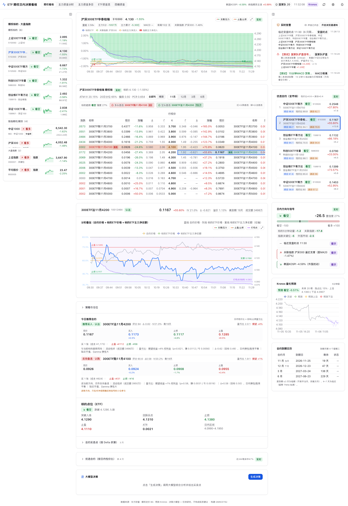
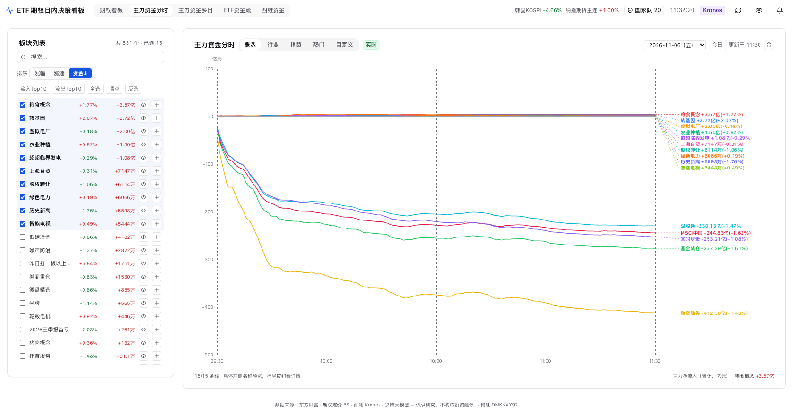
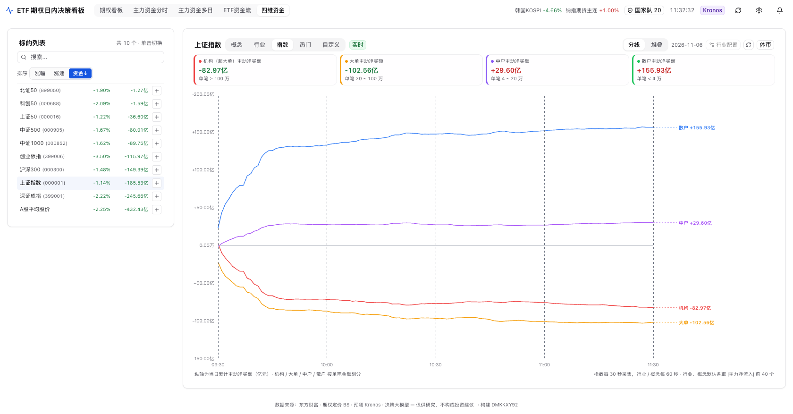

# ETF 期权日内决策看板

面向 A 股场内 ETF 期权（6 个标的）的**日内交易决策系统**：实时行情 + 期权链/隐波 + 资金流 +
关联指数 + 国家队护盘信号 + Kronos 量化预测，并由**大模型**综合给出当天 1~2 次买卖的
入场/止盈/止损方案。前端为 REUI + Tailwind v4 深色看板，支持声音与弹窗告警。

> 仅供研究学习，不构成投资建议。

## 界面预览

**期权看板**：行情/期权链/分时 + 策略仓位 + 优选合约 + 大模型决策 + 实时告警



**主力资金分时**：概念/行业/指数/热门/自定义，右侧虚线标签直连曲线



**四维资金**：机构/大单/中户/散户主动净买额分线或堆叠



## 覆盖标的（可交易期权的 6 只 ETF）

按跟踪指数去重，每个指数只留一只成交最活跃的代表（见
`docs/adr/0004-期权标的收敛为6只.md`）；159919 / 159922 / 588080 已于 2026-11-04 下线。

| 标的 | 代码 | 期权简称前缀 | 关联指数 |
|---|---|---|---|
| 上证50ETF华夏 | 510050 | 50ETF | 上证50 |
| 沪深300ETF华泰柏瑞 | 510300 | 300ETF | 沪深300 |
| 中证500ETF南方 | 510500 | 500ETF | 中证500 |
| 科创50ETF华夏 | 588000 | 科创50 | 科创50 |
| 创业板ETF易方达 | 159915 | 创业板ETF | 创业板指 |
| 深证100ETF易方达 | 159901 | 深证100ETF | 深证100 |

## 快速开始

```bash
# 1) 构建前端（首次）
bash web/build.sh

# 2) 启动后端（含监控循环 + 托管前端）
bash run.sh
# 打开 http://127.0.0.1:6799
```

前置：Python 解释器用 `~/.browser-use-env/bin/python3`（已含 fastapi/uvicorn/httpx）。
Kronos 预测依赖本地 `facecat-kronos` 仓库的 `.venv` 与模型权重；缺失时看板其余功能正常，
预测区域提示离线。

### 开机自启（macOS launchd）

已安装为 LaunchAgent `com.etf-option-board`（登录/重启后自动运行，崩溃自动拉起）：

```bash
# 状态
launchctl print gui/$(id -u)/com.etf-option-board | grep -E "state|pid|runs"
# 日志
tail -f /tmp/etf-option-board.log
# 停止 / 卸载
launchctl bootout gui/$(id -u) ~/Library/LaunchAgents/com.etf-option-board.plist
# 重新安装（仓库内模板 deploy/com.etf-option-board.plist）
cp deploy/com.etf-option-board.plist ~/Library/LaunchAgents/
launchctl bootstrap gui/$(id -u) ~/Library/LaunchAgents/com.etf-option-board.plist
```

### 开发模式

```bash
bash run.sh          # 后端 :6799
bash web/dev.sh      # 前端 :5273（/api 代理到 6799）
```

### Docker 部署

未配置 `ETF_IMAGE` 或将其设为空时，默认使用**当前仓库的 GHCR 镜像**：
`ghcr.io/<owner>/<repo>:latest`，路径自动转为小写。例如：

- 原仓库 `xiwen0217/etf-option-board` → `ghcr.io/xiwen0217/etf-option-board:latest`
- fork `vissong/etf-option-board` → `ghcr.io/vissong/etf-option-board:latest`

在克隆的仓库根目录使用以下入口；`scripts/compose.sh` 优先读取环境变量
`GITHUB_REPOSITORY`，否则从 Git 的 `origin` 识别仓库，支持 HTTPS 和 SSH 地址。
它不会修改 `.env`，其中的 `ETF_IMAGE` 可覆盖默认镜像：

```bash
bash scripts/compose.sh pull
bash scripts/compose.sh up -d --no-build   # 打开 http://<主机IP>:6799
bash scripts/compose.sh logs -f
# 后续升级再次执行 pull，再执行 up -d --no-build
```

Compose 本身不能读取 Git 信息。如果部署端只有 `docker-compose.yml`，请在同目录
`.env` 中设置 `GITHUB_REPOSITORY=xiwen0217/etf-option-board`（换成实际来源仓库），
或直接设置完整的 `ETF_IMAGE`，再执行 `docker compose pull && docker compose up -d --no-build`。
未配置且无法识别仓库时会明确报错。

如需从当前源码构建，执行 `bash scripts/compose.sh up -d --build`。
前端在镜像构建阶段生成，无需提交 `web/dist/`；本地构建不会自动推送 GHCR。

#### GitHub Actions 自动发布

`.github/workflows/publish-image.yml` 使用运行仓库自身的 `github.repository` 生成镜像路径，
以该仓库的 `GITHUB_TOKEN` 登录 GHCR（工作流声明 `packages: write`），不需要 Docker Hub 账号。
合并到原仓库后，原仓库的工作流就会发布到 `ghcr.io/xiwen0217/etf-option-board`；
fork 启用 Actions 后，在其默认分支运行则发布到 fork 自己的路径。

- 默认分支收到 push（包括 PR 合并）：自动构建并推送同一镜像的两个标签：
  `latest` 和构建开始时的北京时间版本 `YYYYMMDD-HHmmss`，例如 `20261106-143015`。
- Actions 页面可选择默认分支手动运行，仍生成上述两个标签；其他分支跳过发布。
- 固定历史版本时，在 `.env` 设置 `ETF_IMAGE=ghcr.io/<owner>/<repo>:20261106-143015`。
  镜像的 OCI version 标签使用时间版本，revision 标签保留源码提交哈希。
- PR 只构建验证，不登录或推送 GHCR。构建目标为 `linux/amd64` 和 `linux/arm64`。
- Dockerfile 的 OCI 来源/版本标签由工作流或 Compose 传入，镜像关联到实际构建它的仓库。

镜像首次发布默认为私有。需要免登录部署时，由仓库所有者在 GitHub Packages 设置中将镜像设为公开；
私有镜像则需先登录 `ghcr.io`。详见 [GitHub Container Registry 文档](https://docs.github.com/en/packages/working-with-a-github-packages-registry/working-with-the-container-registry)。

#### 运行约定

- 数据（设置、自选、板块库、分钟线累积）保存在命名卷 `etf-data`，挂载到容器内 `/app/data`。
  重建容器会复用该卷；`docker compose down -v` 会删除卷及其中的数据。
- Dockerfile 与 Compose 都设置 `TZ=Asia/Shanghai`：交易时段判断使用本地时间，不要改成 UTC。
- 大模型决策：在 `docker-compose.yml` 同目录的 `.env` 写 `LLM_API_KEY=...`。容器里没有 opencode CLI，
  免费额度用尽后不会回落 CLI 通道。
- Kronos 预测在容器内不可用（依赖宿主机上的 facecat-kronos 环境），预测区显示离线。
- `/api/admin/restart` 会先关闭后台资源再退出主进程，由 Compose 的 `restart: unless-stopped`
  自动拉起，无需在容器里运行 LaunchAgent。手动 `docker compose stop` 后不会自动拉起，
  需用 `bash scripts/compose.sh up -d` 恢复。`/api/admin/deploy` 不支持容器内重建前端，改代码后请重建镜像。
- `/api/admin/*` 没有鉴权，默认端口对所有网卡开放；只想本机访问就把 `ports` 改成 `127.0.0.1:6799:6799`。

## 目录结构

```
ETF/
├─ app.py                 FastAPI 入口（lifespan 启动监控 + Kronos 预热）
├─ config.py              配置（token/利率/关键时点/Kronos/LLM）
├─ routers/api.py         全部 HTTP 接口 + SSE 告警流
├─ services/
│  ├─ em.py               东方财富客户端（直连 + curl 兜底 + TTL 缓存）
│  ├─ universe.py         标的/指数/外围/国家队 清单与映射
│  ├─ option_service.py   期权链、T型报价、合约优选、IV/希腊字母装配
│  ├─ bs.py               Black-Scholes 隐波/希腊字母/溢价率
│  ├─ indicators.py       EMA/MACD/ATR/量能/背离/支撑压力
│  ├─ market_service.py   指数、ETF行情/资金流、国家队护盘、外围
│  ├─ strategy.py         方向评分、信号、买卖点、止盈止损
│  ├─ kronos.py           Kronos 预测子进程桥（复用 facecat-kronos）
│  ├─ llm.py              大模型决策（结构化 JSON）
│  ├─ alerts.py           告警总线（发布/订阅/历史）
│  └─ monitor.py          实时轮询触发告警
└─ web/                   REUI + React + Vite + Tailwind v4 前端
```

## 数据来源

东方财富公开接口（`push2 / push2his / emdatah5`）。期权链为 `fs=m:10`（沪）/`m:12`（深）
按简称前缀切分；K 线 `klt∈{1,5,15,30,60,101}`（3 分钟由 1 分钟聚合）；资金流用
`stock/fflow/kline/get`。隐波与希腊字母由本系统按 BS 口径自算（与市场口径一致）。

详见 `CONTEXT.md`（架构、策略逻辑、以及进一步提升期权交易的专业建议）。
